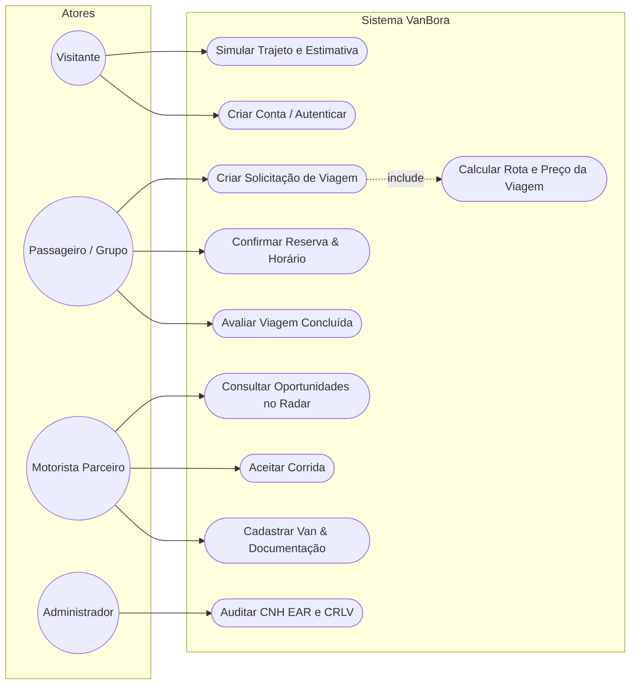
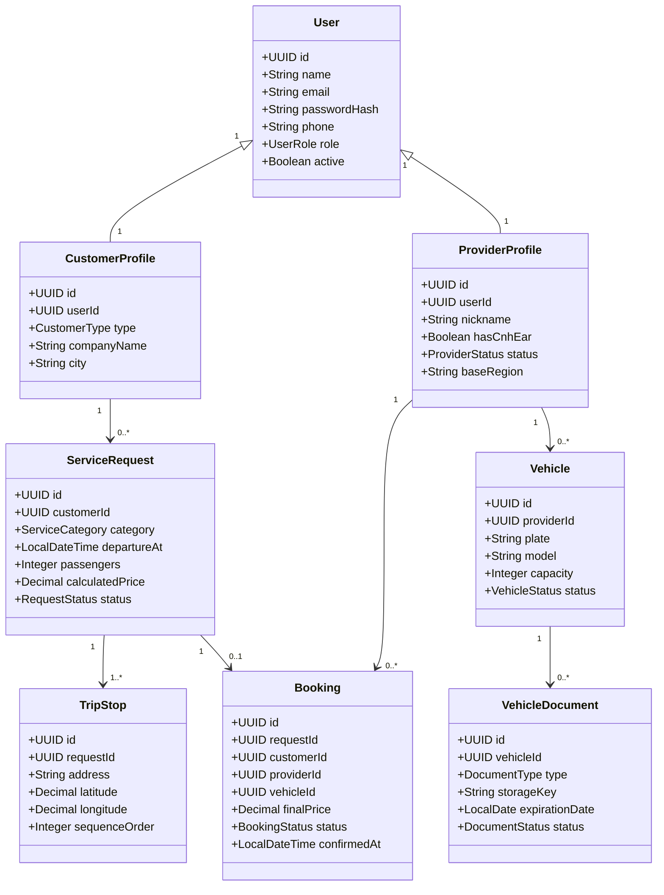

# VanBora — Decisões Técnicas, Domínio e Arquitetura

Este documento consolida a fundação de Engenharia de Software do **VanBora**, servindo como guia prático de estudo e implementação técnica para backend (Java 21 + Spring Boot), frontend (React + TypeScript) e nuvem (Oracle Cloud Infrastructure).

---

## 1. Processo para Tomada de Decisão Técnica (ADR Framework)

Antes de adotar qualquer biblioteca, padrão ou tecnologia, cada funcionalidade crítica deve passar pelo ciclo:
1. **Definição do Problema Real**: Qual dor do passageiro, motorista ou negócio estamos resolvendo?
2. **Requisitos & Restrições**: Requisitos funcionais (RF), não funcionais (RNF) e regras de negócio (RN).
3. **Avaliação de Alternativas**: Prós, contras, custo, complexidade e manutenibilidade.
4. **Registro em ADR (Architecture Decision Record)**: Documentação no repositório.
5. **Implementação & Validação**: Cobertura com testes unitários e medição do resultado.

---

## 2. Requisitos e Regras de Negócio

### 2.1 Requisitos Funcionais (RF)
* **RF-001 [Autenticação]**: O sistema deve permitir cadastro e login diferenciado para Passageiro (PF/PJ) e Motorista Parceiro.
* **RF-002 [Cálculo de Preço Justo]**: O sistema deve calcular automaticamente a estimativa de valor da viagem com base em distância estimada, tempo e tipo de veículo, sem leilão abusivo.
* **RF-003 [Solicitação de Viagem]**: O cliente pode criar solicitações com múltiplos pontos de embarque/desembarque na Grande SP.
* **RF-004 [Radar de Oportunidades]**: O motorista com documentação ativa pode visualizar corridas disponíveis em sua região de base e aceitá-las.
* **RF-005 [Formalização de Viagem]**: A contratação deve gerar um registro imutável com os dados do motorista, van selecionada, valor acordado e compromisso de horário.
* **RF-006 [Auditoria de Documentos]**: O administrador deve analisar e aprovar/reprovar CNH D com EAR e CRLV do veículo com justificativa fundamentada.

### 2.2 Requisitos Não Funcionais (RNF)
* **RNF-001 [Segurança e Controle de Acesso]**: Autenticação stateless via JWT protegido em cookie HttpOnly com verificação de papéis (`CLIENT`, `PROVIDER`, `ADMIN`).
* **RNF-002 [Conformidade com LGPD]**: Dados sensíveis (documentos pessoais, telefone, endereço residencial) com acesso restrito e sem exposição pública.
* **RNF-003 [Integridade Transacional]**: Operações de aceitação de corrida devem ser atômicas e com lock otimista/pessimista para impedir que dois motoristas fechem a mesma solicitação simultaneamente.
* **RNF-004 [Arquitetura Modular]**: Organização de código no modelo **Package by Domain**, desacoplando regras de negócio de frameworks e banco de dados.

### 2.3 Regras de Negócio (RN)
* **RN-001**: Um motorista só pode aceitar corridas se possuir CNH com observação EAR válida e CRLV em dia aprovados pela moderação.
* **RN-002**: Uma proposta aceita torna a solicitação `CONTRACTED` e invalida automaticamente as demais propostas concorrentes.
* **RN-003**: O valor da viagem é calculado pela plataforma com base na quilometragem e tempo médio de espera, garantindo remuneração justa ao motorista e economia ao grupo.
* **RN-004**: Documentos vencidos suspendem automaticamente o status de elegibilidade do prestador para novas viagens.

---

## 3. Diagramas UML Formais

### 3.1 Diagrama de Casos de Uso


### 3.2 Diagrama de Classes de Domínio


---

## 4. Arquitetura Backend: Java 21 + Spring Boot (Package by Domain)

```text
com.vanbora
├── VanBoraApplication.java
├── shared
│   ├── config
│   ├── security          # Filtros JWT, SecurityFilterChain, CustomUserDetailsService
│   ├── exception         # GlobalExceptionHandler, BusinessRuleException
│   └── domain            # AggregateRoot, BaseEntity, ValueObject
│
├── identity              # Autenticação, Usuários, Perfis
│   ├── api               # AuthController, LoginRequestDTO, TokenResponseDTO
│   ├── application       # AuthenticateUserUseCase, RegisterCustomerUseCase
│   ├── domain            # User, Role, PasswordEncoderPort
│   └── infrastructure    # UserRepositoryJpa, SecurityJwtAdapter
│
├── fleet                 # Vans, Capacidade, Documentos de Vistoria
│   ├── api               # VehicleController, DocumentController
│   ├── application       # RegisterVehicleUseCase, SubmitDocumentUseCase
│   ├── domain            # Vehicle, VehicleDocument, VehicleStatus
│   └── infrastructure    # VehicleRepositoryJpa, OciObjectStorageService
│
├── requests              # Solicitações de Viagem, Trajetos e Paradas
│   ├── api               # RequestController, CreateTripRequestDTO
│   ├── application       # CalculateTripPriceUseCase, PublishRequestUseCase
│   ├── domain            # ServiceRequest, TripStop, RouteCalculatorPort
│   └── infrastructure    # RequestRepositoryJpa, GoogleMapsRouteAdapter
│
└── bookings              # Fechamento de Viagem, Concorrência e Histórico
    ├── api               # BookingController
    ├── application       # ConfirmBookingUseCase (com @Transactional e Lock)
    ├── domain            # Booking, BookingStatus
    └── infrastructure    # BookingRepositoryJpa
```

---

## 5. Guia Prático das 5 Frentes de Dificuldade

### 1. Segurança & Spring Security
* **Conceito Chave**: `SecurityFilterChain` com `UsernamePasswordAuthenticationFilter` interceptando o token JWT.
* **Controle Fino**: Uso de `@PreAuthorize("hasRole('PROVIDER')")` nas rotas do motorista.
* **Prevenção de Invasão de Conta (BOLA / IDOR)**: Validar sempre se o `userId` autenticado é o mesmo proprietário da entidade antes de permitir alterações.

### 2. JWT (JSON Web Token)
* **Estrutura**: `Header` (algoritmo), `Payload` (claims: id, email, role, expiração), `Signature` (chave secreta HMAC-SHA256 ou RSA).
* **Segurança**: Tempo de vida curto (ex: 15 a 60 minutos) para o Access Token, armazenado em cookie `HttpOnly; Secure; SameSite=Strict`.

### 3. Testes Unitários & Mockito
* **Princípio**: Teste regras de negócio sem subir o banco de dados.
* **Exemplo**: Testar se o cálculo de valor da van adiciona corretamente a taxa de espera ou se bloqueia motoristas com CNH vencida.
* **Ferramentas**: JUnit 5, Mockito (`when().thenReturn()`, `verify()`), AssertJ.

### 4. LGPD no VanBora
* **Minimização**: O motorista recebe apenas o ponto de embarque e contato de WhatsApp necessário para a viagem.
* **Armazenamento Privado**: Imagens e PDFs de documentos de veículos ficam em bucket privado da nuvem (OCI Object Storage) e são acessados apenas via URLs pré-assinadas com tempo de expiração curto.

### 5. Design System
* **Tokens Centrais**:
  * Azul Noturno Asfalto (`#16233B`): Texto e autoridade.
  * Azul Royal Urbano (`#2764E8`): Ações e links.
  * Amarelo Van (`#F5A623`): Destaques e identidade acolhedora.
  * Marfim Suave (`#FAF8F5`): Superfície e conforto visual.
* **Componentes reutilizáveis**: Consistência entre as telas de visitante, cliente, motorista e admin.
