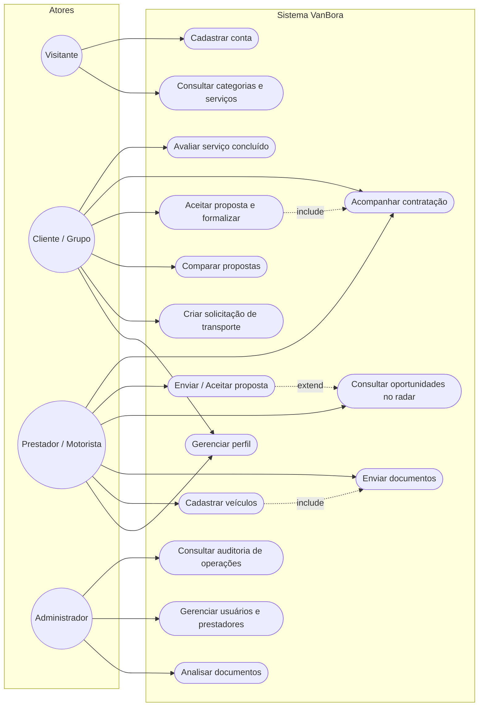
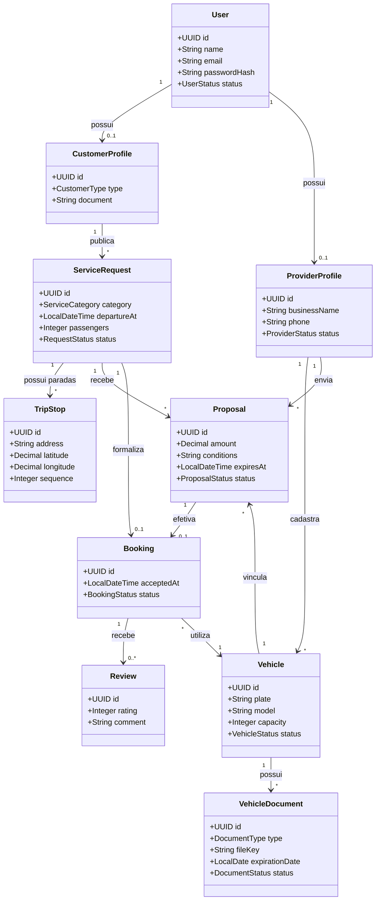

# VanBora — Modelo de Domínio e Diagramas UML

Este documento consolida a modelagem visual do **VanBora**, servindo como referência para a implementação das entidades, relacionamentos e casos de uso no backend (Java 21 / Spring Boot) e no frontend (TypeScript / React).

---

## 1. Diagrama de Casos de Uso

---

## 2. Diagrama de Classes de Domínio

Representação formal do modelo conceitual (conforme capturas das frentes de dados):

---

## 3. Decisões Importantes de Modelagem

1. **Separação entre Identidade e Papéis de Negócio**:
   - `User` contém apenas credenciais e status de acesso (e-mail, hash de senha, status).
   - `CustomerProfile` armazena dados de quem contrata (PF ou PJ, CNPJ/CPF).
   - `ProviderProfile` armazena os dados do prestador/motorista.
   - Isso permite que um mesmo usuário possa ser cliente e motorista sem duplicação de credenciais.

2. **Paradas Flexíveis (`TripStop`)**:
   - A entidade `TripStop` permite múltiplos pontos de embarque ou desembarque com ordem de sequência (`sequence`), latitude e longitude.

3. **Imutabilidade da Contratação (`Booking`)**:
   - Uma vez aceita a proposta, o `Booking` registra o estado imutável da viagem, preservando o valor, o veículo e as condições negociadas, mesmo que o motorista altere dados do perfil posteriormente.

4. **Documentos Vinculados ao Veículo (`VehicleDocument`)**:
   - A documentação de CRLV e vistoria fica associada diretamente a cada van cadastrada, com chave de armazenamento em Object Storage e data de validade para auditoria.
